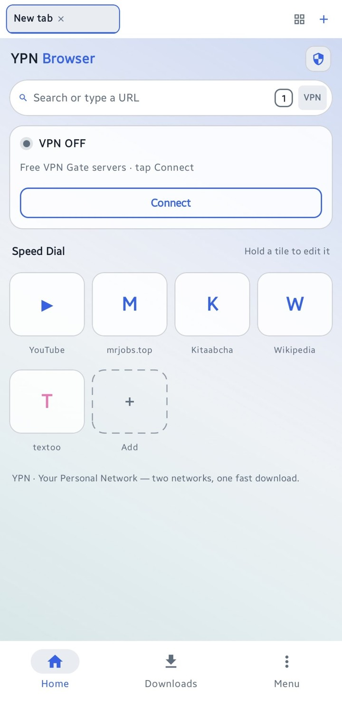
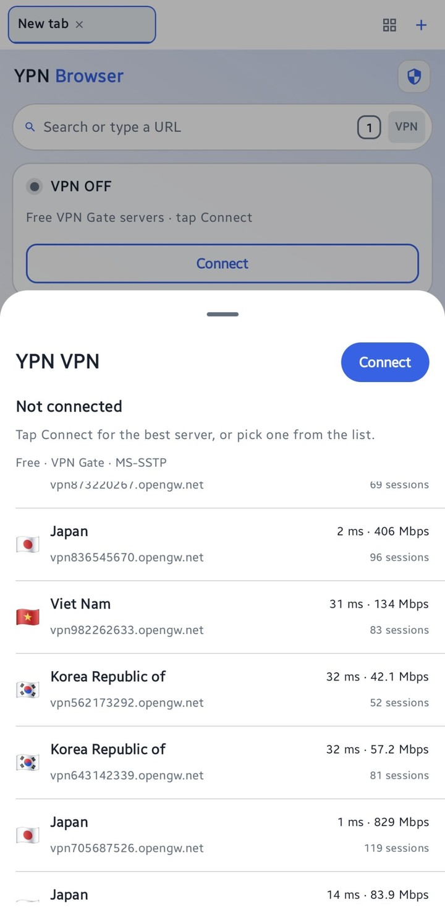
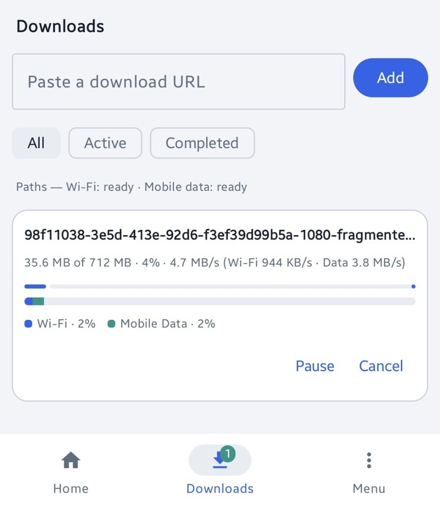
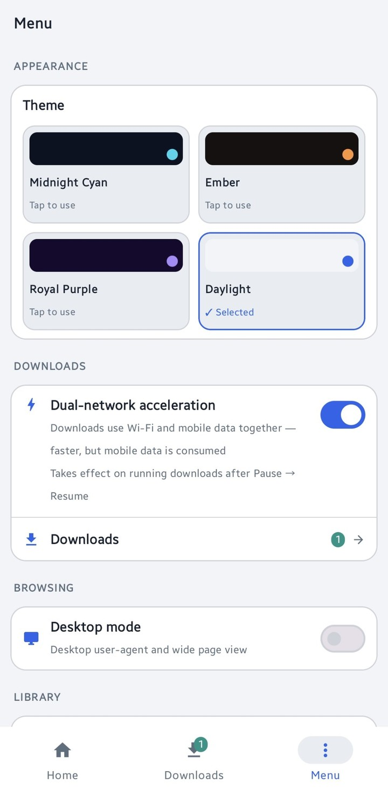

# YPN Browser

**YPN · Your Personal Network — two networks, one fast download.**

An Android browser with a **built-in free VPN** and a **dual-network download
accelerator**: when you download a file, YPN splits it into chunks and pulls
some of them over **Wi-Fi** and the rest over **mobile data — at the same
time**, so the two connections add up instead of sitting idle.

### ⬇ [Download the APK](https://github.com/sufii429/ypn-browser/releases/download/build-latest/ypn-browser.apk)

Android 8.0 or newer · No account · No sign-up · Free

---

## Screenshots

| Home | Free VPN | Downloads | Menu & themes |
| --- | --- | --- | --- |
|  |  |  |  |

---

## What makes YPN different

Most download managers open several connections on **one** network. YPN opens
connections on **both of your networks at once**:

- One file, downloaded over Wi-Fi **and** mobile data simultaneously
- Live per-network view: how much each path carried, and at what speed
- If one path stalls, the remaining work shifts to the healthy one
- Pause and resume keep the exact byte position — even after the app closes
- Large files are split into parallel chunks, and slow chunks at the tail are
  split again so a single slow connection never holds the whole file hostage

In testing, a 699 MB file downloaded over Wi-Fi and mobile data together,
with pause/resume keeping the split and the counters exact.

## Built-in free VPN

- Free public relays from the [VPN Gate](https://www.vpngate.net) project
- Connects over **MS-SSTP** (TLS on TCP port 443) — one tap from the home
  screen or the VPN tab
- Servers that worked for you are remembered and surfaced first, with their
  ping and speed shown before you connect
- No account, no subscription, no data caps from the app itself

*Honest note: VPN Gate servers are run by volunteers, so speed and uptime
vary from server to server. Best suited to everyday browsing.*

## Video fetcher

- Browse a page and YPN detects downloadable video and HLS streams on it
- Shows the real file sizes before you download, with the available
  qualities to pick from
- Downloads go through the same dual-network engine as everything else

## Everyday browsing

- Tabbed browsing with a tab strip and tab grid
- Four themes: Midnight Cyan, Ember, Royal Purple and Daylight
- Speed Dial on the home screen (hold a tile to edit it)
- Bookmarks and history, desktop mode, pop-up blocking

## Privacy shape

YPN has **no accounts, no backend and no tracking**. Your tabs, downloads and
settings live on your phone, and downloads go straight from the source site
to your device.

## Install

1. Download the APK from the link above
2. Open it and allow installing from your browser when Android asks
3. Done — updates install on top, no need to uninstall first

## Honest limitations

- A few hosts only accept one IP address per download; on those, YPN falls
  back to the single healthy path automatically
- VPN Gate relays are volunteers — a server that is offline simply will not
  connect; pick another from the list
- Android 8.0 (API 26) or newer is required

## Built with

- Kotlin + Jetpack Compose (Material 3), Android WebView
- SSTP engine based on [Open SSTP Client](https://github.com/kittoku/Open-SSTP-Client)
  by kittoku (MIT)
- VPN server list from [VPN Gate](https://www.vpngate.net), an academic
  research project of the University of Tsukuba, Japan

## About the developer

Designed and built by **Mazeen** ([@sufii429](https://github.com/sufii429)) —
portfolio: [sufyanaura.netlify.app](https://sufyanaura.netlify.app)
